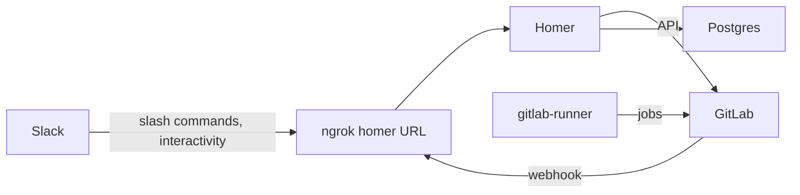

# Homer docker setup

Run [Homer](https://github.com/ManoManoTech/homer) locally against a local GitLab CE and your own Slack app, to try or develop the merge request review and release flows.

`docker compose` runs four containers:

| Service | Container | Port | Role |
|---|---|---|---|
| `homer` | `homer` | 3000 | Homer, `ghcr.io/manomanotech/homer:v2.3.0` |
| `postgres` | `homer-postgres` | 5432 | Homer's database |
| `gitlab` | `homer-gitlab` | 8929 | GitLab CE at http://localhost:8929 |
| `gitlab-runner` | `homer-gitlab-runner` | – | Runs CI jobs of the local projects |

`start-tunnels.sh` exposes Homer and GitLab through ngrok so Slack and GitLab can reach Homer, then points the GitLab webhook and the Slack app at the new Homer URL.



## Prerequisites

- macOS or Linux, `bash`, `curl`, `python3`, `openssl`
- Docker with Compose v2 (`docker compose up --wait`). GitLab needs memory: give the Docker VM at least 6 GB (Colima: `colima start --memory 6`)
- [ngrok](https://ngrok.com/download) v3 and a free account: `ngrok config add-authtoken <token>`. Optionally claim your free static domain in the ngrok dashboard → Domains
- A Slack workspace where you can create apps

## First setup

1. Configuration files:
   ```bash
   cp .env.example .env
   cp homer-config/projects.example.json homer-config/projects.json
   ```
   Fill `POSTGRES_PASSWORD`, `GITLAB_ROOT_PASSWORD` and `GITLAB_SECRET` (`openssl rand -base64 32`) in `.env`.
2. Start the stack and wait for GitLab (first boot takes several minutes):
   ```bash
   docker compose up -d --wait --wait-timeout 900
   ```
3. GitLab: user, token, project and webhook → [docs/how-to/gitlab-setup.md](docs/how-to/gitlab-setup.md)
4. CI runner → [docs/how-to/gitlab-runner.md](docs/how-to/gitlab-runner.md)
5. Slack app → [docs/how-to/slack-app.md](docs/how-to/slack-app.md)
6. Apply the new `.env` values and the project list:
   ```bash
   docker compose up -d homer
   ```

## Daily use

```bash
./start-tunnels.sh --dry-run   # starts everything, prints the planned webhook and Slack changes only
./start-tunnels.sh             # starts everything and updates the webhook and the Slack app
```

The script keeps the tunnels open until Ctrl-C. Stop the stack with `docker compose down` (data stays in the docker volumes; `docker compose down -v` deletes it).

`start-tunnels.sh` needs these `.env` keys (an exported variable overrides `.env`):

| Key | Example | Notes |
|---|---|---|
| `GITLAB_TOKEN` | | Homer's GitLab token, also used to update the webhook |
| `GITLAB_SECRET` | | set as the webhook secret token |
| `GITLAB_WEBHOOK_PROJECT` | `root/my-project` | project path |
| `GITLAB_WEBHOOK_ID` | `1` | the number in `/-/hooks/<id>/edit` |
| `GITLAB_NGROK_DOMAIN` | `my-name.ngrok-free.dev` | optional static ngrok domain; unset gives a random URL |
| `HOMER_PORT` | `3000` | optional, defaults to 3000 |
| `SLACK_APP_ID` | `A0123456789` | optional; when set, the app's slash command, interactivity and event subscription URLs point to Homer |
| `SLACK_CONFIG_ACCESS_TOKEN` | `xoxe.xoxp-…` | app configuration token, 12 h |
| `SLACK_CONFIG_REFRESH_TOKEN` | `xoxe-…` | single use; the script rotates an expired access token and writes both new tokens back to `.env` |

The free ngrok plan allows one agent session: stop any other `ngrok` before running the script.

## More

- [docs/how-to/](docs/how-to/README.md) – setup guides and troubleshooting
- [examples/sample-project/.gitlab-ci.yml](examples/sample-project/.gitlab-ci.yml) – a pipeline that exercises Homer's release flow
- [Homer documentation](https://github.com/ManoManoTech/homer#readme) – commands, release managers, plugins
